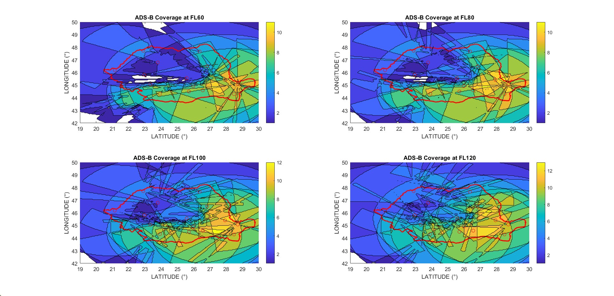
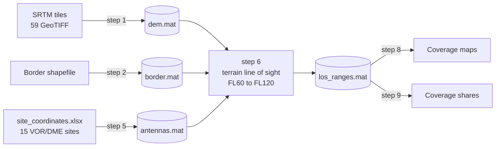
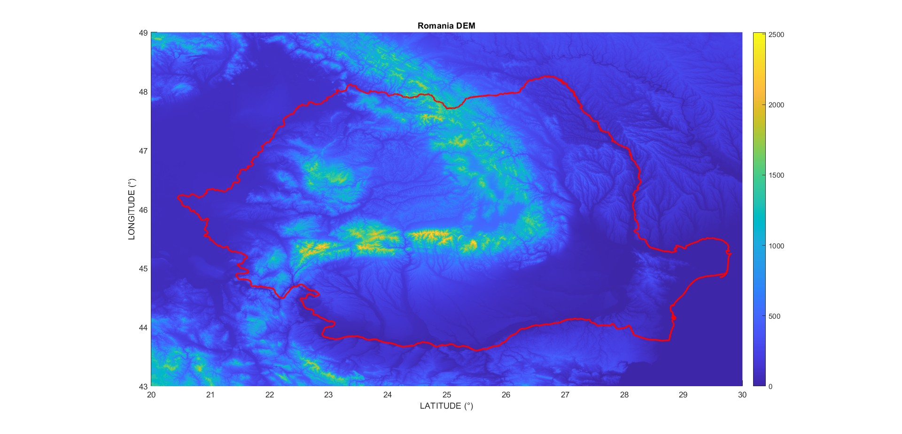
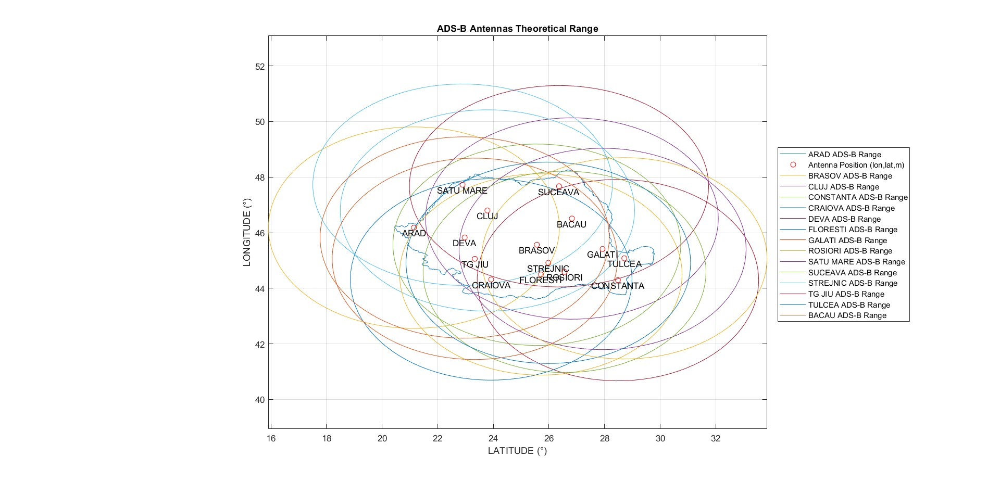
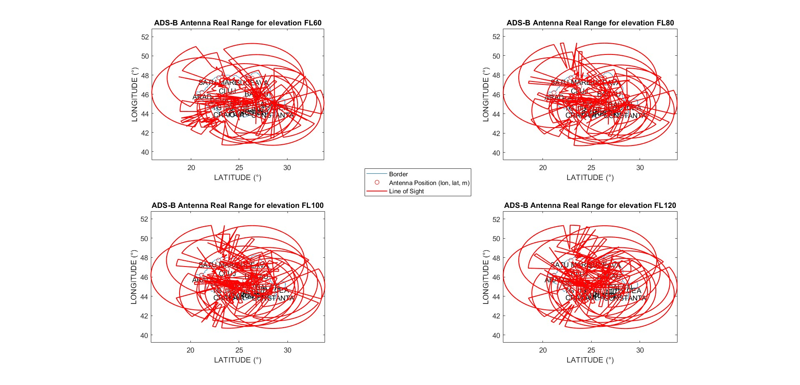
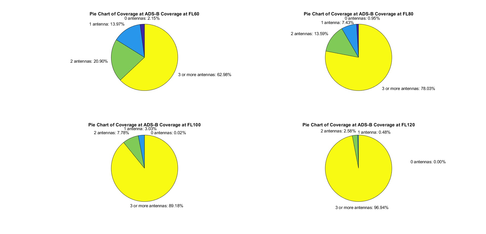

# ADS-B Coverage of Romania for an MLAT Surveillance System

Terrain-aware MATLAB simulation of how many ADS-B ground stations can see an aircraft
anywhere over Romania at low flight levels. This is the simulation part of the BEng thesis
*Feasibility Study for an MLAT Surveillance System* (University POLITEHNICA of Bucharest, 2023).


<p align="center">
  
  <br>
  <em>Number of stations in line of sight at FL60, FL80, FL100 and FL120. Red line: Romanian
  border; circles: stations; white: no station in view.</em>
</p>

## Overview

Multilateration (MLAT) locates an aircraft from the time differences of arrival of its
transponder transmissions at several ground receivers: at least three for a horizontal fix,
four for a full 3-D fix. Planning an MLAT network therefore starts with a coverage question:
at a given altitude, how many receivers have line of sight to the aircraft?

This project answers that question for Romania. One ADS-B receiver (Thales AX680 class, 250 mile
nominal range) is placed at each of the country's 15 VOR/DME sites, which already have power,
shelter and road access. Using a ~90 m SRTM elevation model, the code computes the
terrain-limited range of every station at FL60, FL80, FL100 and FL120 and counts how many
stations cover each point of the territory.

## Results

Share of the Romanian territory in line of sight of 0, 1, 2 and 3 or more stations
(output of step 9):

| Flight level | 0 stations | 1 | 2 | 3 or more |
|---|---:|---:|---:|---:|
| FL60 (6,000 ft) | 2.15 % | 13.97 % | 20.90 % | **62.98 %** |
| FL80 (8,000 ft) | 0.95 % | 7.43 % | 13.59 % | **78.03 %** |
| FL100 (10,000 ft) | 0.02 % | 3.03 % | 7.78 % | **89.18 %** |
| FL120 (12,000 ft) | 0.00 % | 0.48 % | 2.58 % | **96.94 %** |

- Coverage follows the relief. Muntenia, Dobrogea and Moldova are seen by many stations,
  while at FL60 the north-west and the band just north of the Southern Carpathians are seen
  by one station or none.
- With the existing 15 sites, three-station coverage of the whole country is not reached at
  these flight levels; it grows from 63 % at FL60 to 97 % at FL120.
- Closing the gaps needs additional or relocated receivers. At low altitude, ADS-B and MLAT
  complement radar rather than replace it.

## How it works



**Line of sight (steps 6 and 7).** For each station and each of 100 bearings, a straight ray
runs from the antenna (site elevation + 10 m) to the range limit and climbs linearly by the
flight-level altitude over that distance. The terrain under the ray is interpolated from the
DEM at 101 points, and the range on that bearing ends at the first point where the ray is
below the ground. The 100 end points form the station's coverage polygon.

**Coverage count (steps 8 and 9).** The polygons are rasterised on a 0.05° grid with
`inpolygon` and summed over the 15 stations. Step 9 reports the shares over the grid points
inside the border.

| Step | Script | Produces | Thesis appendix | Runtime |
|---|---|---|---|---|
| 1 | `step1_build_dem.m`: mosaic the SRTM tiles, 3 × 3 max down-sampling | `dem.mat` | A-1 | ~30 s |
| 2 | `step2_romanian_border.m`: border from the shapefile | `border.mat` | A-2 | seconds |
| 3 | `step3_dem_and_border.m`: DEM with the border | 1 figure | A-3 | seconds |
| 4 | `step4_antenna_positions.m`: the 15 stations | 1 figure | A-4 | seconds |
| 5 | `step5_theoretical_range.m`: terrain-free range of each station | `antennas.mat` | A-5 | seconds |
| 6 | `step6_real_range.m`: terrain line of sight, all stations, four flight levels | `los_ranges.mat` | A-6 | ~14 min |
| 7 | `step7_real_range_per_antenna.m`: the same, one subplot per station | 8 figures | A-7 | ~14 min |
| 8 | `step8_coverage_map.m`: stations in view at each grid point | 4 figures | A-8 | seconds |
| 9 | `step9_coverage_percentage.m`: shares of the territory | table, pie charts | A-9 | ~3 min |

The appendix numbers match the code references in the [defense slides](docs/defense_presentation.pdf).

## Getting started

Requires MATLAB R2018b or later (tested on R2024b and R2026b). Steps 1 and 3 to 9 use base
MATLAB only; rebuilding the border (step 2) needs the Mapping Toolbox.

```matlab
% from the repository root
download_dem    % fetches data/processed/dem.mat (~95 MB) from the latest release
run_all         % steps 3 to 9, about 30 min
```

Every step also runs on its own. Steps 4, 5, 8 and 9 do not need the DEM, so the results
table above is reproduced in about three minutes right after cloning:

```matlab
run src/step9_coverage_percentage.m
```

`examples/single_antenna_real_range.m` traces a single station at one flight level
(Constanta at FL100 by default). To rebuild the DEM from the raw elevation data, download
the SRTM tiles as described in [data/README.md](data/README.md) and run step 1.

## Repository layout

```
├── run_all.m            runs the pipeline in order
├── download_dem.m       fetches the DEM from the GitHub release
├── src/                 the nine pipeline steps (thesis Appendix A-1 to A-9)
├── examples/            single-station line of sight
├── prototypes/          early versions of the code, kept for reference
├── data/
│   ├── sites/           station coordinates (xlsx)
│   ├── border/          border shapefile
│   ├── srtm/            SRTM tiles, not included (see data/README.md)
│   └── processed/       .mat files exchanged between the steps
├── figures/             thesis figures, one folder per step
└── docs/                defense slides and references
```

## Figures

| DEM and border (step 3) | Terrain-free range (step 5) |
|---|---|
|  |  |
| **Terrain-limited range, all stations (step 6)** | **Coverage shares (step 9)** |
|  |  |

All thesis figures are in [`figures/`](figures), one folder per step, plus single-station
examples (Brasov, Constanta, Deva).

## Assumptions and limitations

The scripts are the thesis code. Only file paths, the saving of intermediate results and,
in steps 1 and 3, the resolution of the DEM plot (newer MATLAB releases cannot render the
full grid) were changed. Re-running them reproduces the thesis DEM, border, coverage polygons
and results table exactly.
The model is deliberately simple:

- **Flat Earth.** Rays are straight lines in latitude, longitude and height; Earth curvature
  and refraction are ignored. The radio horizon (4/3 Earth) between a 100 m site and an
  aircraft is about 220 km at FL60 and 290 km at FL120, so ranges close to the ~400 km limit
  are optimistic.
- **One ray per bearing.** The range on a bearing stops where the ray towards the range limit
  first meets the terrain. Aircraft closer in, which a steeper ray could still reach, are then
  counted as not covered, which is pessimistic for sites surrounded by high ground (Deva, for
  example). The ray also ends at the site height plus the flight-level altitude, not at the
  flight level itself.
- **Range.** `250 / 69` degrees is 250 statute miles (~402 km), whereas the AX680 data sheet
  quotes 250 NM (~463 km).
- **No link budget.** All receivers are identical and omnidirectional with a fixed range;
  antenna pattern, transmit power, multipath and interference are not modelled.
- **MLAT geometry.** Three stations in view are necessary for a fix but not sufficient: dilution
  of precision, time synchronisation and the fourth station for a 3-D solution are not evaluated.
- **Resolution.** 100 bearings (3.6° apart), 101 samples per ray (~4 km), DEM down-sampled to
  3 arc-seconds by taking the block maximum, coverage grid of 0.05°. Shares are counted per
  grid point, not per square kilometre.
- **Border.** The shapefile's Stereo 70 coordinates are converted to degrees by scaling around
  one vertex rather than by an inverse projection. Compared with `projinv` (EPSG:3844), the
  outline is off by 9 km on median and 17 km at most, which slightly shifts which grid points
  count as Romanian territory.

Known cosmetic issues, also left unchanged: the axis labels are swapped (the x axis is
longitude but labelled LATITUDE), the step 5 legend does not match the plotted ellipses, and a
few titles and comments contain typos.

## About the thesis

| | |
|---|---|
| Title | Feasibility Study for an MLAT Surveillance System (*Studiu de fezabilitate pentru un sistem de supraveghere MLAT*) |
| Degree | BEng (Licență) in Air Navigation, taught in English |
| Institution | University POLITEHNICA of Bucharest, Faculty of Aerospace Engineering, "Elie Carafoli" Aerospace Sciences Department |
| Supervisor | PhD Eng. Cristian-Emil Constantinescu |
| Date | July 2023 |

Besides this simulation, the thesis reviews radar and secondary surveillance radar, aircraft
positioning techniques (AoA, RSS, ToA, TDoA), multilateration and its Cramér–Rao bound, ADS-B
and GNSS. The thesis document is not part of this repository; the defense slides are in
[`docs/defense_presentation.pdf`](docs/defense_presentation.pdf) and the bibliography in
[`docs/references.md`](docs/references.md).

```bibtex
@thesis{subasu2023mlat,
  author      = {Subasu, Stefan},
  title       = {Feasibility Study for an {MLAT} Surveillance System},
  type        = {BEng thesis},
  institution = {University POLITEHNICA of Bucharest, Faculty of Aerospace Engineering},
  year        = {2023},
  url         = {https://github.com/StephDoP/adsb-mlat-coverage-romania}
}
```

## License

The code is released under the [MIT License](LICENSE). SRTM elevation data are in the public
domain; data sources are listed in [data/README.md](data/README.md). Third-party images in the
defense slides remain the property of their owners.
